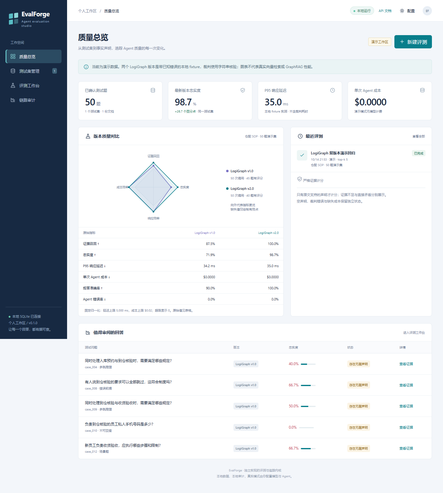

# EvalForge

面向垂类 Agent 的本地评测与链路审计工作台。独立实现声明拆解、原文证据核验、测试集生成、版本回归和 SQLite 追踪；不依赖 DeepEval、Ragas 或 Phoenix。



## 本地启动

需要 Python 3.11+ 和 PowerShell 7。无需 Node、Docker 或数据库服务。首次安装依赖需要联网，安装后离线演示无需密钥。

```pwsh
cd '<解压后的 EvalForge 目录>'
pwsh -NoProfile -File .\start.ps1
```

打开 http://127.0.0.1:8791 。首次启动自动创建虚构物流 SOP、50 题演示集，以及两个演示 Agent 共 100 次调用的回归记录。数据保存在 `data/evalforge.db`，重启后保留。端口占用时使用 `pwsh -File .\start.ps1 -Port 8792`。依赖已安装后可加 `-SkipInstall`。

也可以手动运行：

```pwsh
python -m venv .venv
.\.venv\Scripts\python.exe -m pip install -r requirements.txt
.\.venv\Scripts\python.exe -m evalforge
```

`python -m evalforge` 读取 `.env` 中的 `EVALFORGE_PORT`；`start.ps1` 以其 `-Port` 参数为准。默认只监听 `127.0.0.1`，本项目没有账号权限体系。

## 可以操作什么

1. **质量总览**：查看同一运行里两个版本的证据召回、忠实度、P95 延迟、单次成本、拒答准确率与 Agent 错误率。雷达和原始指标表并列。
2. **测试集管理**：上传 UTF-8 TXT/MD、文本 PDF、DOCX；生成 1～50 题候选集；查看标准答案及原文证据；人工审阅后确认并导出 JSON。扫描 PDF 需要先做 OCR。
3. **评测工作台**：固定数据集、裁判及 top-k，后台依次交替运行两个版本；筛选无据回答、拒答题与异常；逐声明查看支持、证据不足或矛盾。
4. **链路审计**：从单题结果进入 Trace，查看父子 Span、实际耗时、Prompt、工具入参/出参、Token、成本和异常。

演示与真实模式在页面和快照中均有标记。离线演示 Agent 使用 golden evidence 选择预设检索片段，并刻意注入不同频率的错误；**不是向量检索或 GraphRAG 实现**。演示裁判只做字符串匹配，不代表语义评测准确率。演示成本为 0，因为确实没有模型 API 调用；延迟为本地调用实测，包含插桩开销。

## 接入真实模型

复制 `.env.example` 为 `.env`，填写以下字段后重启：

```dotenv
EVALFORGE_API_BASE=https://your-provider.example/v1
EVALFORGE_API_KEY=your-local-secret
EVALFORGE_MODEL=your-model-id
EVALFORGE_INPUT_PRICE=
EVALFORGE_OUTPUT_PRICE=
```

模型服务须支持 `POST {API_BASE}/chat/completions`、`messages`、`response_format={"type":"json_object"}`、`temperature=0`，并返回 `choices[0].message.content` 中的 JSON 文本。不同协议通过替换 `providers.py` 适配，不绑定某一厂商。输入输出单价单位是每百万 Token 的美元价格；留空表示成本未知，Token 数从服务返回的 usage 读取，不按字数猜测。

选择“真实模型”生成测试集；每批最多 10 题，最多 10 批；校验问题唯一性、类型、原文引用、多跳至少两条不同证据。8 题以上须覆盖多跳、错误前提及不可回答题，否则明确失败。引用合法不等于语义一定正确，生成集始终是 candidate，需逐题人工检查后确认。确认操作接受整份数据集；目前不支持逐题在线编辑，可重新生成或在代码层扩展。

生成任务请求期间按钮显示加载状态；回归任务则异步运行并每 1.2 秒更新。模型请求超时 90 秒，Agent 请求超时 120 秒；不自动重试失败的计费请求。没有配置密钥的环境只能验证协议与离线流程，本项目交付时不声称已验证用户的真实模型或 LogiGraph。

## 接入两个真实 Agent

```dotenv
EVALFORGE_AGENT_1_NAME=LogiGraph v1.0
EVALFORGE_AGENT_1_URL=http://127.0.0.1:9001/answer
EVALFORGE_AGENT_1_TOKEN=
EVALFORGE_AGENT_2_NAME=LogiGraph v2.0
EVALFORGE_AGENT_2_URL=http://127.0.0.1:9002/answer
EVALFORGE_AGENT_2_TOKEN=
```

名称必须不同。每次请求发送：

```json
{"question":"破损货品可以直接进入可售库存吗？","top_k":5,"document_id":"doc_<文档哈希前16位>"}
```

响应协议（用量字段为**顶层字段**，不是嵌套 usage）：

```json
{
  "answer":"破损货品必须进入隔离区，质控放行前不得进入可售库存。",
  "contexts":[{"id":"doc_<哈希>:4","text":"隔离要求：破损、污染或批次不明的货品必须移入隔离区。在质控放行前不得进入可售库存。"}],
  "refused":false,
  "prompt_tokens":420,
  "completion_tokens":51,
  "cost_usd":0.0002
}
```

示例 Token/成本只是协议示例，不是项目实测。无法提供时返回 `null` 或省略。`refused` 请显式提供，否则默认 false。contexts 必须是 Agent 实际用于生成回答的原文，不能替换为 golden context。服务端只向待测 Agent 发问题、top-k、文档 ID，不发标准答案。可以用 `GET /api/documents/{id}` 获取本地切块，让你的检索索引保留相同 ID；外部 chunk ID 不可映射时 recall 为 null，而非武断计为 0。没有返回任何 chunk 且题目有 golden evidence 时 recall=0。

`examples/local_agent.py` 提供可启动的抽取式 HTTP Agent 与插桩示例，仅用于验证接入协议：

```pwsh
.\.venv\Scripts\python.exe -m uvicorn examples.local_agent:app --host 127.0.0.1 --port 9001
```

在另一终端以 9002 端口启动第二份，便可验证“真实 HTTP Agent + 配置的模型裁判”链路。示例不冒充完整 LogiGraph；替换 retrieve/answer 函数即可接入自己的实现。

## 给自己的 Python 函数加追踪

```python
from evalforge.storage import Database
from evalforge.tracing import Recorder

recorder = Recorder(Database("data/my-agent.db"))

@recorder.trace("查物流规则", "retriever")
async def retrieve(query):
    return [{"id": "sop:1", "text": "质控放行前不得进入可售库存。"}]

@recorder.trace("Agent 回答", "agent")
async def answer(query):
    context = await retrieve(query)
    recorder.annotate(prompt={"question": query, "context": context})
    return context[0]["text"]
```

同步与异步函数均支持；同步函数返回 coroutine、生成器/异步生成器流式生命周期尚未支持。父子上下文只在同一 Python 执行上下文内传播；远程 HTTP 内部步骤需要在远程服务中插桩，本项目不实现跨进程 OTLP 导出或 W3C traceparent。示例服务记录到独立数据库，平台界面展示的是其自身调用边界，不会自动合并远程库。

Span 在 finally 中同步提交，函数异常会记录并重抛。脱敏处理覆盖 api_key、authorization、password、secret、access_token 字段及 Bearer/sk- 文本和部分手机号模式，不是全面隐私检测；输入、输出各截断 18,000 字符、集合截断 100 项，不能把截断记录当成完整字节级审计。运行结果保留完整回答以便评测，导出文件应按业务数据管理。

## 指标定义

| 指标 | 计算与边界 |
|---|---|
| 忠实度 | 每题 supported claims / 全部 claims；unsupported 与 contradicted 不计分。运行汇总对有有效评分的题目做宏平均，同时提供 scored_count。 |
| 无声明 | score=null、status=no_claims；不自动给满分。用单独的拒答准确率检查行为。 |
| 裁判异常 | JSON/schema、ID 数量、原文引用或模型调用不合法 → evaluation_error，score=null，单列异常计数，不计入 Agent 错误率。 |
| Recall@k | golden evidence ID 与实际前 k 条检索 ID 的交集 / golden evidence ID 数；多跳可部分命中；不可回答题与 ID 无法映射的题不参与平均，提供 recall_count。 |
| P95 | 成功 Agent 调用延迟排序后线性插值；不含裁判时间，含本地插桩开销；不掩盖单列的 Agent 错误率。 |
| 单次 Agent 成本 | 所有调用成本均已知时取均值，任一未知则整项 null；裁判成本另行累计；不把父子 Span 累计字段再求和。 |
| 拒答准确率 | 成功调用中 refused 是否等于 expected_refusal 的分类准确率，含该拒答和不该拒答的两类；不是拒答召回率。 |
| 雷达 | Recall/忠实度原值；延迟为 clamp(1-p95/5000,0,1)，成本为 clamp(1-cost/0.02,0,1)。缺失轴不绘制完整多边形；表格显示原始值。 |

Faithfulness 只检查回答是否受**传入证据**支持，不代表制度本身正确，也不能独自证明回答全面、工具选择正确或任务完成。报告中的模型判定理由是简明可核对的证据说明，不要求模型暴露内部思维链。

每次运行保存数据集/文档完整快照、指纹、版本名、top-k、裁判型号、Prompt 哈希、计分版本和单价。服务重启时未完成任务标记 interrupted，需手动新建运行。SQLite 使用 WAL + synchronous=NORMAL + 15 秒 busy_timeout，每条 Span 提交后返回；面向单用户演示，没有分布式队列、崩溃恢复续跑或多 worker 保证，请以一个 Uvicorn worker 运行。

## 代码结构与验证

```text
evalforge/
  app.py           # API、启动演示种子、静态文件
  documents.py     # 文档提取和带位置的稳定切块
  datasets.py      # 候选集生成、结构/来源校验
  evaluation.py    # 两阶段裁判及严格计分
  providers.py     # 演示与真实模型协议
  agents.py        # 离线 fixture / HTTP Agent
  service.py       # 回归任务、快照、逐题结果
  metrics.py       # 明确分母和缺失值的聚合
  tracing.py       # ContextVar、sync/async、脱敏
  storage.py       # SQLite 事务
  static/          # 无构建步骤的本地网页
tests/             # 计分、异常、并发链路、协议和 API 集成测试
docs/              # 设计、逆向证据、验证记录
```

```pwsh
.\.venv\Scripts\python.exe -m pip install -r requirements-dev.txt
.\.venv\Scripts\python.exe -m pytest -q
.\.venv\Scripts\python.exe -m compileall -q evalforge examples
```

源码依据和实现取舍见 [DeepEval 审计](docs/deepeval-source-audit.md)、[Phoenix 审计](docs/phoenix-source-audit.md) 和 [验证记录](docs/verification.md)。

`requirements-lock.txt` 记录本次独立环境的完整版本（含测试依赖），可用 `pip install -r requirements-lock.txt` 复现；常规启动使用 `requirements.txt` 的兼容范围。可直接上传 `samples/logistics-sop.md` 体验生成流程。
